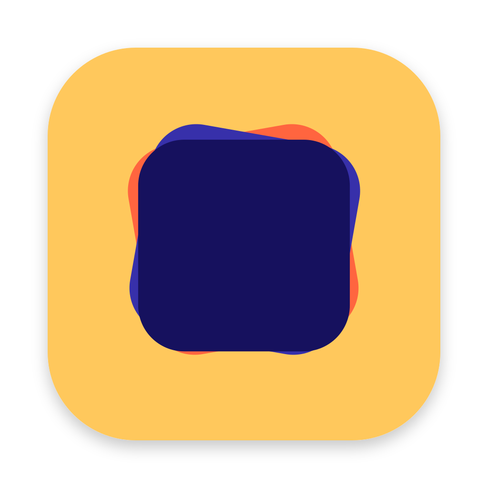

<div align="center">



# GitDeck

A desktop Git client for GitHub, GitLab.com and self-hosted GitLab.

[Features](#features) · [Install](#install) · [Accounts](#connecting-an-account) · [Develop](#getting-started) · [Docs](#docs)

</div>

<br />

Browse every repository you can reach, read its commit graph, group repositories from different hosts into Projects, and put two repositories side by side. Built with Electron, React and TypeScript.

## Features

|              |                                                                                                                                                                      |
| ------------ | -------------------------------------------------------------------------------------------------------------------------------------------------------------------- |
| **Connect**  | GitHub.com, GitHub Enterprise, GitLab.com and self-hosted GitLab, any number of accounts. Open any local folder, clone over HTTPS or SSH, or link an existing clone. |
| **Read**     | Lane graph of the whole history (500 commits per page, virtualised), repository overview, file history and blame, pull and merge requests with CI status.            |
| **Change**   | Stage by file, hunk or line. Commit, branches, push and pull, stash, cherry-pick, merge, tags, revert, reset, remotes, rebase (also interactive) and bisect.         |
| **Resolve**  | Merge conflicts resolved in the app, region by region.                                                                                                               |
| **Organise** | Projects (named groups of repositories from any host), Split View (two repositories at once), a command palette, hide branches and tags per repository.              |
| **Extras**   | Optional AI commit messages, an integrated terminal, PR/MR notifications, light and dark themes with five accents.                                                   |

<details>
<summary>More detail</summary>

- **Repository overview.** Commits, contributors, branches, tags, open pull or merge requests, languages and top contributors. Saved data shows first and refreshes in the background. If a refresh fails, the saved data stays and a banner offers Retry.
- **Local clones.** Fetch, open the folder, and read local branch, ahead/behind and working tree state.
- **History operations.** Tags (create, annotate, push, delete here or on the remote), revert, reset (soft, mixed or hard, with a confirm for hard), remotes (add, rename, remove), rebase onto a branch or commit, and interactive rebase from a graph row (reorder, reword, squash, fixup, drop). Revert and rebase reuse the conflict banner, and a rebase can skip the commit it stopped on. URLs never carry a token.
- **Bisect.** Start from a graph row. A banner shows the commit under test with Good, Bad, Skip and Abort, then the result.
- **Pull and merge requests, CI.** A tab with state, author, reviewers, labels and checks, plus a status dot beside the branch in the graph. "Create PR/MR" opens the host's compare page.
- **Notifications.** Off by default. In Edit project, pick the events to watch: new, merged, closed, reviewer requested, checks failed. GitDeck checks the project's hosted repositories every 2 minutes while it is open (no webhooks, nothing leaves your machine but the usual API reads). Clicking a notification opens the PR/MR tab. Settings > Notifications turns them all off and sends a test notification.
- **AI commit messages.** Off by default. A sparkles button fills the message field from the staged diff using the Claude Code, Codex or OpenCode CLI, or OpenAI, Gemini or any OpenAI-compatible server with a key kept in the OS keychain. It never commits.
- **Terminal.** A shell per pane, opened with the Terminal button or Ctrl+\`, in the repository's folder.
- **Command palette.** `Mod+Shift+P` jumps to repositories, branches and tags and runs actions such as fetch, pull and theme switch.
- **Split View.** Each pane keeps its own tab, graph and scroll position, with a draggable divider.
- **Appearance.** Light, dark or system theme, five accent colours and a choice of font. Accounts are connected in Settings too.

</details>

## Install

Download the dmg for your Mac (`arm64` for Apple silicon, the plain one for Intel) from [Releases](https://github.com/nitipon-apaisri/git-deck/releases) and drag GitDeck to Applications.

The build is ad-hoc signed but not notarised (there is no Developer ID), so macOS blocks the first launch with "Apple could not verify GitDeck is free of malware". Once per downloaded build:

1. Click **Done** (not Move to Trash).
2. Open System Settings, Privacy & Security.
3. Click **Open Anyway** next to the GitDeck notice.

Or run `xattr -dr com.apple.quarantine /Applications/GitDeck.app` and open the app again. On macOS 15 and later, right-click, Open no longer bypasses the prompt. A build with no signature at all shows "GitDeck is damaged" on Apple silicon; the `xattr` command clears that too.

GitDeck does not update itself. Settings, About, Check for updates asks GitHub for the latest release and links to its page. Nothing is checked at launch. To update, download the new dmg and replace GitDeck in Applications. Silent auto-update needs a Developer ID signature and notarisation, which are not set up.

## Connecting an account

Open **Accounts**, pick a host, paste a token, press **Test connection**, then **Add account**. GitDeck only ever sends the token to that host.

| Host   | Token                                                                                                                                                               |
| ------ | ------------------------------------------------------------------------------------------------------------------------------------------------------------------- |
| GitHub | A classic token with the `repo` scope, or a fine-grained token with read access to **Metadata** and **Contents** (read and write **Contents** to push).             |
| GitLab | A personal access token with the `api` and `read_repository` scopes (`api` is what creates merge requests; `read_api` still reads; add `write_repository` to push). |

Cloning a private repository over HTTPS uses the same token. For SSH, GitDeck uses whatever your own `ssh` setup already does.

**Self-hosted hosts**

- Choose **GitLab self-hosted** or **GitHub Enterprise** and type the base URL, for example `https://git.example.com`. A path prefix such as `https://example.com/gitlab` works. A missing `https://` is added.
- Internal certificate authorities work without any setting, because GitDeck uses the operating system's certificate store.
- A host with a self-signed certificate needs **Allow self-signed certificate for this host**. It is per host, never global, and it also applies to the `git` commands for that host.

## Getting started

Needs Node.js 22.12 or newer, [pnpm](https://pnpm.io) (other package managers are not supported), and `git` on your `PATH`. For tokens to be stored you need an OS keychain that Electron can use (macOS Keychain, Windows DPAPI, or a Linux secret service); see [Security model](#security-model).

```sh
pnpm install
pnpm dev        # run the app with hot reload
pnpm build      # production build into out/
pnpm test       # unit and integration tests (node:test through tsx)
pnpm typecheck  # TypeScript, main and renderer
pnpm lint       # ESLint
```

`pnpm format` runs Prettier. A pre-commit hook runs lint-staged and a secret scan (gitleaks). Build an installer with `pnpm package` (output in `dist/`).

<details>
<summary>Notifications under <code>pnpm dev</code> on macOS</summary>

The Electron that pnpm installs is only linker-signed, so macOS never lists it in System Settings > Notifications and refuses its notifications (`UNErrorDomain error 1`). Sign it once: `codesign --force --deep --sign - node_modules/electron/dist/Electron.app`, restart `pnpm dev`, click **Send a test notification** in Settings > Notifications and allow it when macOS asks. Reinstalling Electron undoes this. The packaged app is signed by electron-builder and does not need it.

</details>

## Keyboard shortcuts

`Mod` is Ctrl on Windows and Linux, Cmd on macOS. `Mod+K` is ignored while a dialog is open, so it never steals a keystroke from a form.

<details>
<summary>All shortcuts</summary>

| Shortcut                  | What it does                                                       |
| ------------------------- | ------------------------------------------------------------------ |
| `Mod+K`                   | Focus the sidebar filter. Opens the sidebar first if it is closed. |
| `Esc` in the filter       | Clear the filter. A second press leaves the field.                 |
| `Mod+Alt+S`               | Turn Split View on or off.                                         |
| `Mod+1`, `Mod+2`          | Focus pane 1 or pane 2 (Split View).                               |
| `Up`, `Down`              | In the graph: select the previous or next commit.                  |
| `PageUp`, `PageDown`      | In the graph: move by a page of commits.                           |
| `Home`, `End`             | In the graph: first or last loaded commit.                         |
| `Esc` in the graph        | Close the commit details.                                          |
| Arrow keys on the divider | Move the Split View divider by 2%. Double-click it to centre it.   |
| Arrow keys in a menu      | Move between items. `Enter` or `Space` chooses, `Esc` closes.      |
| `Esc` in a dialog         | Close the dialog.                                                  |

</details>

## Projects

A project is a named group of repositories from any host or account, with its own icon and colour.

1. Open the scope switcher at the top of the sidebar and choose **New project…**, or right-click a repository (or use its `…` button) and choose **New project…**.
2. Give it a name (1 to 60 characters, unique ignoring case), an icon (built in, or one emoji) and a colour, and tick the repositories.
3. Choose the project in the scope switcher. The sidebar then shows only its repositories, still grouped by host and namespace. Repositories that no loaded list has any more (access lost, account removed) wait in an **Unavailable** group with a remove button.
4. **Project overview** shows totals, a sortable table and "Fetch all linked". Commits and open requests are sums over the repositories that reported a value. Contributors are merged across the top 25 of each repository and are approximate (`~`). A **Partial** badge means some counts are missing.

Deleting a project never touches the repositories or your local clones. Removing an account removes its repositories from every project.

## Architecture

```
src/main       Electron main process. Owns every side effect: window, IPC, store, http, tls, git, providers.
src/preload    contextBridge: exposes window.api, nothing else.
src/renderer   React UI. Talks to main only through window.api.
src/shared     Domain types, the IPC contract and pure code (graph layout, project helpers). No electron import.
tests          node:test through tsx.
docs           Design system, UI boards, DECISIONS.md.
```

<details>
<summary>How it fits together</summary>

- **Main** holds the accounts, the encrypted tokens, the caches and the project list in the user data folder (`config.json`, `cache.json`, written atomically). Providers (`GitHubProvider`, `GitLabProvider`) turn an account and a token into repositories and summaries. `git.ts` runs `git` and parses its output.
- **The renderer sends keys, not locations.** It names a repository by its key (`accountId:remoteId`) and a project by its id. Main looks the repository up in its own cache, and only runs git in folders that are linked to a repository. The one URL it can pass is a web link to open in your browser, and main refuses anything but `http` and `https`.
- **Pure code is kept apart from Electron.** Anything that does not need Electron does not import it, so it runs under `tsx` in plain tests. The renderer's logic (graph paging, split state, project rows, sorting) is in `renderer/src/lib` as pure functions; React hooks are in `renderer/src/state`.
- **The graph** is laid out by a stateful lane-assignment class (`src/shared/graph-layout.ts`) that accepts pages as they load. Rows are SVG, drawn only for the visible range.
- **Panes are independent.** There is no global "current repository". Each pane owns its tab, summary, graph and scroll, so two can sit side by side.
- **Styling** is CSS Modules with design tokens (`docs/design-system/tokens.css`). Components use `var(--…)` only, never a hex value. The theme is a `data-theme` attribute on `<html>`.
- The only runtime dependencies are `react`, `react-dom` and `node-pty` (the one native module, for the integrated terminal). Fonts, UI libraries and build tools are dev dependencies.

</details>

## Security model

- **Tokens are encrypted** with Electron `safeStorage` (the OS keychain) before they touch disk, and are decrypted only in the main process to make a request. If secure storage is unavailable, GitDeck refuses to store a token. On Linux, the plaintext `basic_text` fallback counts as unavailable.
- **A token never leaves its host.** It goes in a request header to that account's own host. It is never put in a URL, a log line, an error message, `.git/config` or the arguments of a process.
- **Git gets its credentials from the environment.** For clone and fetch, GitDeck sets a one-off `GIT_CONFIG_*` variable that adds an `Authorization` header for that single origin. Nothing is written to the repository's config, and other hosts get nothing.

<details>
<summary>More</summary>

- **IPC is a narrow, validated surface.** `window.api` offers fixed functions. Main validates every argument at runtime, and errors go back as plain messages with no stack.
- **The window is locked down.** `contextIsolation` on, `nodeIntegration` off, the renderer sandboxed, a Content Security Policy that forbids inline scripts, and navigation limited to the app itself. Links to web pages open in your browser, and only `http` and `https` ones.
- **TLS is checked by default.** The self-signed option is stored per host and applies to nothing else.
- **A pre-commit secret scan** (gitleaks) runs on every commit.

</details>

## Known limits and roadmap

- Developed and checked on macOS, against mock GitHub Enterprise and GitLab servers, and used against a real self-hosted GitLab instance. Not run against github.com or gitlab.com, or on Windows or Linux.
- A repository's summary can take a moment on a large repository: counts come from several API calls, and a host that rate-limits you may return partial counts. Partial totals are marked as such.
- Only the first 25 contributors of each repository are read, so contributor totals are approximate.
- Split View has two panes at most.
- The graph shows the history that `git log` reports for the linked folder. Detached HEAD and graphs with more than about ten lanes at once were not checked.

Not planned for this version: a full-file three-way editor, OAuth sign-in (tokens only), a SQLite cache, silent auto-update, signing and notarisation, more than two panes, drag-and-drop between projects, and cloning every repository of a project at once.

## Docs

- [`PLAN.md`](PLAN.md): the build brief. [`docs/DECISIONS.md`](docs/DECISIONS.md): each call the brief left open.
- [`docs/RELEASING.md`](docs/RELEASING.md): branches, the `/stage`, `/release` and `/hotfix` commands, and release gotchas.
- [`docs/design-system/`](docs/design-system/) and [`docs/ui-boards/`](docs/ui-boards/): the visual source of truth.

`main` is released code only, `develop` is where features and fixes land, and `stage` holds the release candidate. Branch from `develop` and merge with `--no-ff`. A `vX.Y.Z-rc.N` tag on `stage` publishes a GitHub pre-release to test; `vX.Y.Z` on `main` is the release, built by `.github/workflows/release.yml`.

## Built with Claude Code

GitDeck was written with Claude Code. Token use for this repository, read from the local Claude Code transcripts on 2026-11-26 (68 sessions and 38 subagent runs since 2026-11-05):

| Tokens      |   Amount |
| ----------- | -------: |
| Output      |    2.74M |
| Fresh input |     8.4K |
| Cache write |    10.0M |
| Cache read  |     448M |
| **Total**   | **461M** |

Most of the total is cache reads, which are billed at a much lower rate, so the total is not a measure of cost. This is a snapshot and is not updated automatically.

## Progress

**43 of 45 phases done.** Tick a phase here when its PLAN.md checkboxes are done and its branch is merged.

<details>
<summary>Phase checklist</summary>

- [x] Phase 1: Scaffold
- [x] Phase 2: Core services (no UI yet)
- [x] Phase 3: Providers
- [x] Phase 4: IPC and main wiring
- [x] Phase 5: Renderer: shell, accounts, sidebar
- [x] Phase 6: Renderer: repo view, overview, info
- [x] Phase 7: Commit graph
- [x] Phase 8: Split View (two repos at once)
- [x] Phase 9: Projects
- [x] Phase 10: Polish and docs
- [x] Phase 11: Changes, diff, stage, commit
- [x] Phase 12: Branches, checkout, push and pull
- [x] Phase 13: Stash, cherry-pick, merge
- [x] Phase 14a: Tags, revert, reset, remotes
- [x] Phase 14b: Rebase and hunk staging
- [x] Phase 15a: Conflict data and whole-file resolution
- [x] Phase 15b: Conflict editor screen
- [x] Phase 16: Line-level staging
- [x] Phase 17: Leaner menus and Delete branch
- [x] Phase 18: AI commit messages (Claude Code CLI)
- [x] Phase 19: Integrated terminal
- [x] Phase 20: Sidebar virtualization
- [x] Phase 21: Command palette
- [x] Phase 22: Pull requests, merge requests and CI
- [x] Phase 23: File history and blame
- [x] Phase 24: Bisect
- [x] Phase 25: Packaging and update notice
- [x] Phase 26: Release workflow (develop, stage, main)
- [x] Phase 27: Line-level discard
- [x] Phase 28: Create pull request / merge request
- [x] Phase 29: More AI providers for commit messages
- [x] Phase 30: Change log detail
- [x] Phase 31: Interactive rebase
- [x] Phase 32: Project event notifications
- [x] Phase 33: Graph commit order (date order)
- [x] Phase 34: Branch badge and double-click checkout
- [x] Phase 35: Notification bell
- [x] Phase 36: Branch management
- [x] Phase 37: Easier notification setup
- [x] Phase 38: Git activity UI
- [x] Phase 39: Button activity and toasts
- [x] Phase 40: Repo header overflow menu
- [x] Phase 41: Hide branches and tags
- [ ] Phase 42: Git worktrees
- [ ] Phase 43: Home profile

</details>
